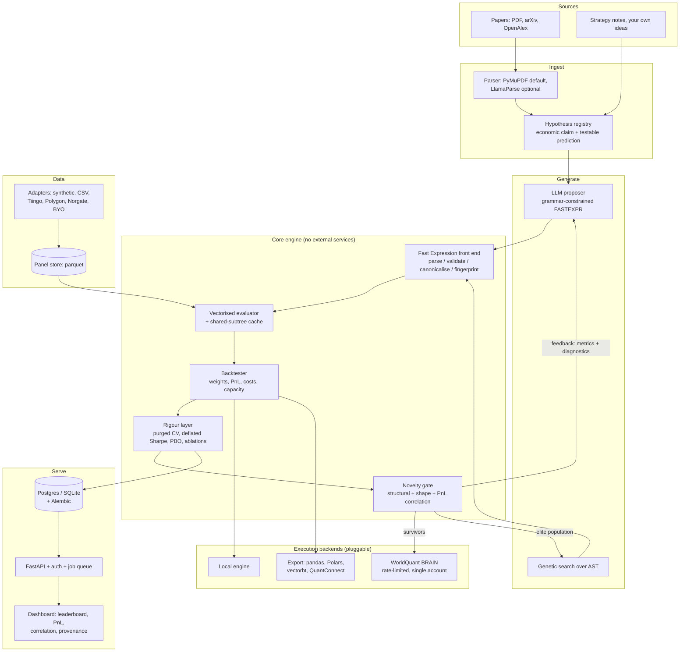

# Brainiac roadmap

_The plan for reviving Brainiac as a self-hostable alpha research platform. Read
[ASSESSMENT.md](ASSESSMENT.md) first for the current state and the evidence behind the
claims here._

---

## 1. The reframe

The original project is **a script that automates a third party's website**. Its core loop
is: ask an LLM for a Fast Expression string, POST it to WorldQuant BRAIN, wait minutes,
record what came back. That framing caps the project in three ways at once:

- **The feedback loop is 1,000× too slow to search.** One account gets ~90–180 simulations
  per hour. Meaningful search over expression space needs tens of thousands.
- **It cannot run without a WorldQuant account**, which makes it undemoable, untestable,
  and unusable by most of its potential audience.
- **It cannot be sold.** The multi-credential rotation exists to defeat BRAIN's concurrency
  limit; that is a terms-of-service problem no product can ship. Alphas submitted to BRAIN
  also carry platform IP entanglement.

The reframe is one sentence:

> **The durable asset is not the LLM call. It is the evaluation harness and the search loop
> wrapped around it.**

LLM inference is a commodity that gets cheaper every quarter. What makes generated alphas
_good_ is everything else: a fast honest backtester, ruthless overfitting control, novelty
management against the signals you already have, and provenance from paper to PnL. That is
the part nobody has built in the open, it is the part that takes real engineering, and it is
the part that is worth money.

So Brainiac becomes a **local-first alpha research operating system**:

| | Before | After |
|---|---|---|
| Evaluation | BRAIN only, minutes per alpha | Local vectorised engine, ~26 ms per alpha; BRAIN optional |
| BRAIN's role | The search loop | The confirmation step for survivors |
| Runnable without keys | No | Yes — synthetic panel + local engine, `docker compose up` |
| Generation | One-shot LLM prompt | Search loop: LLM proposes, engine scores, results feed back |
| Quality bar | In-sample Sharpe | Deflated Sharpe, PBO, walk-forward, cost/capacity, orthogonality |
| Output | Rows in SQLite | A ranked, deduplicated, attributed signal book |

Positioning, once it exists: **"the alpha research OS"** — dbt for quant signals, or
Weights & Biases for factor research. Not a trading bot, not signals-as-a-service. Research
infrastructure.

## 2. Target architecture

The load-bearing design decisions:

1. **The Fast Expression AST is the universal currency.** Everything — validation,
   evaluation, mutation, fingerprinting, export to other DSLs — operates on the AST, never
   on strings. No `eval`, ever.
2. **Every external service is a plugin behind a protocol.** LLM provider, document parser,
   data source, execution backend. The default configuration of each is "works offline".
3. **Content-addressed everything.** An alpha's identity is the structural hash of its
   canonical form. A result's identity is `(alpha hash, panel hash, settings hash)`. This
   gives free caching, free dedupe, and reproducibility.

## 3. Phased plan

Each phase is independently shippable and ends with a demo that works with no API keys.

### Phase 0 — Installable and honest _(in progress on this branch)_

| Item | Status |
|---|---|
| `pyproject.toml`, hatchling, extras (`server`/`llm`/`parse`), `uv.lock` | done |
| ruff + mypy strict + pytest configuration | done |
| Fast Expression lexer, parser, AST, printer | done |
| Operator registry with machine-checkable signatures (163 operators) | done |
| Canonicaliser + structural/shape fingerprints | done |
| Validator with 20 diagnostic codes and autofix | done |
| Field catalogue from CSV exports (1,848 fields, fixes the `datasets_usa.md` crash) | done |
| `Panel` container | done |
| Fix the 14 correctness bugs in [ASSESSMENT.md §6](ASSESSMENT.md#6-bug-and-debt-inventory) | todo |
| Secrets via `pydantic-settings`; delete the plaintext-credentials pattern | todo |
| `LICENSE`, `CONTRIBUTING.md`, `SECURITY.md`, `CODE_OF_CONDUCT.md` | todo |
| CI: lint, typecheck, test matrix, coverage gate | todo |

**Acceptance:** `pip install brainiac` then `brainiac lint 'rank(ts_delta(close, 5))'`
works on a clean machine with no keys and no network.

### Phase 1 — Local evaluation (the unlock)

The single highest-value phase. Everything downstream depends on it.

- **Interpreter** for the operator registry over numpy panels. Target ≥80% of registered
  operators; the remainder raise a clear "not supported locally, needs BRAIN" diagnostic
  rather than failing silently.
- **Shared-subtree cache** keyed on the canonical hash of each subexpression, scoped to a
  panel. In a genetic population most subtrees are shared, so this is close to free
  throughput.
- **Backtester**: signal → cross-sectionally neutralised, truncated, book-size-scaled
  weights → daily PnL. Metrics defined to match BRAIN's: Sharpe, fitness, turnover,
  returns, drawdown, margin, long/short counts.
- **Gate checks** mirroring BRAIN's `LOW_SHARPE`, `LOW_FITNESS`, `LOW/HIGH_TURNOVER`,
  `CONCENTRATED_WEIGHT`, `LOW_SUB_UNIVERSE_SHARPE`, `UNITS`, so an alpha's likely verdict is
  known before submission.
- **Synthetic panel generator** with plantable structure — a configurable momentum,
  reversal, or value effect — so tests can assert that a known-good alpha finds a known
  signal, and the tutorial works with zero setup.
- **Parity harness**: replay recorded BRAIN simulation results and compare local metrics.

**Acceptance:** `brainiac backtest 'rank(-ts_delta(close, 5))' --panel synthetic` prints a
full metric table in under a second. On the parity set, local-vs-BRAIN Sharpe rank
correlation > 0.9 and turnover within 15%.

### Phase 2 — Statistical rigour (the differentiator)

This is what separates a research tool from a Sharpe-mining toy, and almost no open-source
project does it properly. It is also the most credible thing to put in front of a
professional buyer.

- **Purged, embargoed walk-forward cross-validation** instead of one in-sample/out-of-sample
  split, so overlapping label windows cannot leak.
- **Deflated Sharpe ratio** — adjust for the number of trials that produced the winner. A
  search loop that tries 100,000 alphas will find Sharpe 3 in pure noise; without this
  correction the whole platform is a random-number generator with good branding.
- **Probability of backtest overfitting** (combinatorially symmetric CV) per alpha and per
  search run.
- **Multiple-testing control** across a search run: Benjamini–Hochberg, plus White's
  Reality Check / Hansen's SPA for the best-of-N question.
- **Cost and capacity model**: spread and impact as a function of ADV participation, borrow
  cost on the short leg, and the resulting capacity ceiling. Flags the Sharpe-3 alpha that
  dies above $10M.
- **Robustness sweeps**: parameter sensitivity surfaces (an alpha that works only at
  `d = 17` is noise), universe robustness, sub-period stability, region transfer.
- **Lookahead-bias linter and shift test**: statically flag delay-0 use of fields that are
  not point-in-time, then empirically verify PnL degrades when data is shifted.
- **Null controls**: for each candidate, auto-generate the cross-sectionally shuffled
  variant, the sign-flipped variant, and the random-field substitution, and require the real
  alpha to beat all three.

**Acceptance:** a deliberately parameter-mined alpha is flagged with PBO > 0.5 and a
deflated Sharpe indistinguishable from zero, while a planted synthetic signal survives.

### Phase 3 — Search and generation (the "next level")

Only now is it worth pointing an LLM at the problem, because there is finally something to
grade its output with.

- **Novelty gate, three tiers, cheapest first:** exact structural hash → shape hash
  (identical structure, different constants — almost always correlated) → PnL correlation
  against the existing book. Only novel, uncorrelated survivors are kept.
- **Genetic programming over the AST**: window jitter, operator swap within category,
  subtree replacement, crossover, simplification. Fitness = risk-adjusted performance minus
  a correlation penalty against the book, minus a complexity penalty. This is the
  "reinforcement learning framework" the original README promised and never had — and it
  needs no LLM at all, which makes it fully testable offline.
- **LLM in a real loop**: feed the model the validator diagnostics, the backtest metrics,
  the failed gate checks, and the correlation to existing alphas, then ask for a revision.
  Multi-turn refinement beats one-shot generation and is the cheapest large win available.
- **Grammar-constrained decoding**: the operator registry already defines the grammar, so
  emit it as a GBNF/JSON-schema constraint. The model then _cannot_ produce a syntax error.
  This deletes the entire class of "regex the JSON out of the prose" failures the original
  code fought with.
- **Hypothesis registry**: extract the economic _claim_ from a paper as a first-class
  object (claim, predicted sign, required data, horizon, cited evidence) and generate many
  encodings per hypothesis. This separates "the idea" from "the encoding", which is what
  lets you answer the question that actually matters — _does this paper replicate?_
- **LLM as proposal distribution, engine as value function**: beam search or MCTS over
  expression space. This is the genuinely novel, defensible technique, and it is only
  possible because Phase 1 made evaluation cheap.
- **Real retrieval**: embed the field catalogue, operator docs and previously successful
  alphas; retrieve top-k per hypothesis. The README claimed RAG in 2024; the code stuffed a
  whole table into the prompt and the dataset-selection function was a commented-out no-op.

**Acceptance:** on a synthetic panel with a planted effect, the search loop recovers the
planted signal, and beats both a random-expression baseline and one-shot LLM generation on
the out-of-sample deflated Sharpe of the top-10 portfolio.

### Phase 4 — The self-hostable platform

- **Persistence**: SQLAlchemy 2.0 typed models, Alembic migrations, SQLite for local and
  Postgres for deployment. Session-per-request, never a module-global session.
- **Job queue** with idempotency keys, exponential backoff, dead-letter handling, and
  resumability. In-process worker by default; Redis/arq when scaling out.
- **API**: FastAPI with API-key auth, per-key rate limits, OpenAPI, and an audit log.
- **BRAIN as a plugin, done honestly**: async `httpx` client, one account, documented
  concurrency limits respected, token refresh, resumable polling with backoff, biometric
  re-auth surfaced as a queued human-action item instead of a blocking `input()`.
- **Dashboard**: alpha leaderboard, PnL and drawdown charts, correlation heatmap, factor
  exposures, parameter-sensitivity surfaces, and a provenance graph from paper → hypothesis
  → expression → run → result.
- **Observability**: structlog JSON logs, Prometheus metrics, OpenTelemetry traces, and
  per-run LLM cost accounting (tokens and dollars attributed to the alpha they produced).

**Acceptance:** `docker compose up` yields a working multi-user system with a populated
demo workspace, no API keys required.

### Phase 5 — Data and interoperability

- **Data adapters** behind one protocol: synthetic, CSV/parquet directory, Tiingo, Polygon,
  Stooq, Norgate, and a documented bring-your-own-panel contract.
- **Point-in-time correctness**: as-of joins for fundamentals, restatement handling,
  survivorship-bias-free universes with membership churn, corporate-action adjustment.
- **Universe construction**: top-N by ADV or market cap with realistic entry/exit rules.
- **Compile the AST to other targets**: pandas, Polars, vectorbt, QuantConnect, plain
  Python. Alphas should be portable out of any walled garden, including ours.
- **Paper ingestion at scale**: arXiv (q-fin) and OpenAlex have proper APIs and are
  reachable. Note that `papers.ssrn.com` returns 403 to automated clients, so the original
  roadmap item "automated scraping of SSRN papers" should be replaced with those APIs plus
  a manual-upload path rather than a scraper that will break and violate terms.

### Phase 6 — Product surface

- **Portfolio combination**: the deliverable is a portfolio, not a list. Ridge, hierarchical
  risk parity, or mean-variance with an explicit correlation penalty over the surviving book.
- **Factor attribution**: regress alpha PnL on Fama–French and Barra-style factors to show
  what is actually driving it. Most "novel" alphas are short-term reversal in a costume, and
  saying so out loud is a feature.
- **Reporting**: a signed, reproducible PDF/HTML tear sheet per alpha — expression, prose
  explanation, provenance, metrics, robustness surfaces, rigour statistics, cost model.
- **`brainiac explain`**: render an expression as plain English plus a link to the paper it
  came from. Underrated for onboarding and for review.

## 4. Feature catalogue

Ideas worth building, grouped, with why they matter and how invasive they are. Roughly
ordered by value per unit of effort within each group.

### A. Evaluation engine

| Idea | Why | Scope |
|---|---|---|
| Vectorised interpreter over panels | The unlock; everything depends on it | New module, no new deps |
| Shared-subtree result cache | Near-free throughput in population search | Evaluator internals |
| Faster ranking | `argsort∘argsort` is ~40% of runtime; a counting/bucket rank or `bottleneck` is a large constant-factor win | Evaluator hot path |
| GPU / Numba backend behind the same protocol | 10–50× for large sweeps | New optional backend, opt-in dep |
| Incremental evaluation on a rolling window | Enables live/paper-trading mode later | Evaluator + state management |
| Deterministic seeds and content-addressed results | Reproducibility is table stakes for a research tool | Cross-cutting, cheap if done early |

### B. Statistical rigour

| Idea | Why | Scope |
|---|---|---|
| Deflated Sharpe ratio | Without it, a search loop is a noise-mining machine | Metrics module |
| Purged, embargoed walk-forward CV | Correct time-series validation | Backtest harness |
| Probability of backtest overfitting (CSCV) | Per-alpha and per-run overfitting estimate | Metrics module |
| Multiple-testing control across a run | Makes "we tried 100k alphas" defensible | Search + reporting |
| Cost, borrow and capacity model | Separates a real alpha from an illiquid artifact | Backtester |
| Parameter-sensitivity surfaces | Cheapest, most legible overfitting check there is | Sweep runner + dashboard |
| Null and ablation controls | Proves the signal is the signal | Search loop |
| Lookahead linter + empirical shift test | Catches the most expensive class of silent bug | Validator + harness |

### C. Search and generation

| Idea | Why | Scope |
|---|---|---|
| Grammar-constrained FASTEXPR decoding | Eliminates syntax errors by construction | LLM layer; registry already has the grammar |
| Diagnostics-and-metrics feedback loop | Biggest quality win per line of code | LLM layer + orchestrator |
| Genetic programming over the AST | Real search; needs no LLM, fully testable offline | New module on top of the AST |
| Novelty gate (hash → shape → PnL correlation) | Stops the book filling with 400 versions of reversal | New module, cheap |
| Hypothesis registry | Lets you ask "does this paper replicate?" | Schema + prompts |
| Beam search / MCTS with the engine as value function | The defensible research contribution | Orchestrator, depends on B |
| Real embedding retrieval over fields and prior alphas | Delivers the RAG the README promised | LLM layer + optional vector store |
| Multi-model routing and cost accounting | Cheap model proposes, strong model refines | LLM layer |
| Prompt and model versioning tied to results | Otherwise A/B comparisons are meaningless | Schema |
| Learned reranker over generated candidates | Predict backtest quality before evaluating | Needs a corpus of runs first |

### D. Data

| Idea | Why | Scope |
|---|---|---|
| Synthetic generator with plantable effects | Makes the whole system demoable and testable offline | New module, high value |
| Parquet panel store with a stable schema | The interop contract | New module |
| Free/cheap vendor adapters | Removes the WorldQuant dependency entirely | One module per vendor |
| Point-in-time fundamentals and PIT universes | Without it, backtests lie | Invasive; needs a real data model |
| Corporate actions and delisting returns | Survivorship bias is the classic silent killer | Data layer |

### E. Product surface

| Idea | Why | Scope |
|---|---|---|
| Leaderboard + PnL + correlation dashboard | Turns a database into a product | Server + frontend |
| Provenance graph (paper → hypothesis → alpha → result) | The audit story that sells to institutions | Schema + UI |
| Tear-sheet export | The artifact a user shares with their boss | Reporting module |
| `brainiac explain` | Expression → prose; great for review and onboarding | Small, uses the AST |
| Portfolio combination | The real output is a portfolio | New module |
| Factor attribution | Honesty about what an alpha actually is | New module |
| Workspaces, RBAC, SSO | The multi-user/commercial tier | Server, invasive |
| Notebook/Python SDK | Meets quants where they work | Thin wrapper over the core |

### F. Interoperability

| Idea | Why | Scope |
|---|---|---|
| Compile AST → pandas/Polars | Portability; also a differential-testing oracle for the interpreter | New backend |
| Export → vectorbt / QuantConnect / Zipline | Bridges research to execution | One module per target |
| Import alphas written elsewhere | Lowers switching cost; makes the linter useful standalone | Parser front end variants |
| MCP server exposing lint/backtest/search as tools | Lets any coding agent drive Brainiac; very cheap given the CLI | Small wrapper |

## 5. Engineering modernisation and CI

### Repository hygiene

- Delete the `AlphaGenerator/` + `Simulation/` script layout in favour of `src/brainiac/`
  with a real public API; keep the knowledge assets and the sample paper.
- `uv` for environment and lock management, with `uv.lock` committed.
- Conventional commits, generated changelog, semantic versioning.
- `LICENSE`, `CONTRIBUTING.md`, `SECURITY.md`, `CODE_OF_CONDUCT.md`, issue and PR templates.
- Replace every bare `except:` with typed handling; no unbounded recursion as a retry
  strategy; no `input()` below the CLI layer.
- Configuration through `pydantic-settings`: env vars and `.env`, with `.env.example`
  committed. Credentials never in the repo, never in a JSON file next to the code.

### Testing strategy

The point is to make the whole system testable **without any API key**, which the assessment
confirms is achievable.

| Layer | Approach |
|---|---|
| Lexer/parser/printer | Golden files plus a Hypothesis property test: random AST → unparse → parse → identical AST |
| Canonicaliser | Property: equivalent rewrites collide, inequivalent ones do not; canonicalisation is idempotent |
| Validator | One golden-file case per diagnostic code, asserting code, severity and suggestion |
| Interpreter | Differential test against a hand-written pandas reference implementation per operator |
| Backtester | Analytic fixtures with known answers (constant signal → zero PnL, perfect-foresight signal → known Sharpe) |
| Rigour layer | Planted-signal and planted-noise panels with known correct verdicts |
| Search | Seeded runs asserting the planted effect is recovered and elites are uncorrelated |
| LLM layer | Deterministic fake provider plus recorded-response transport; a `network` marker for live runs |
| BRAIN client | Cassette-style recorded HTTP fixtures; live tests behind `network` and a credential check |
| API | `TestClient` against a temporary SQLite database |
| Performance | `pytest-benchmark` with a regression threshold, because throughput is a product feature |

Coverage gate at 85% on `src/brainiac`, with the reporting/dashboard layer excluded.

### CI (GitHub Actions)

| Workflow | Contents |
|---|---|
| `ci.yml` | ruff check, ruff format --check, mypy strict, pytest on 3.11/3.12/3.13 × Linux/macOS, coverage upload and gate |
| `benchmark.yml` | Evaluator throughput benchmark on PRs, failing on >20% regression |
| `security.yml` | `pip-audit`, CodeQL, gitleaks secret scan, Dependabot dependency review |
| `docker.yml` | Build and push a multi-arch image to GHCR, generate an SBOM, sign with cosign |
| `docs.yml` | mkdocs-material build, link check, publish to Pages |
| `release.yml` | Tag-triggered PyPI publish via OIDC trusted publishing, changelog, GitHub release |

Plus `pre-commit` mirroring the lint jobs, and Renovate for dependency updates.

### Self-hosting

- `Dockerfile`: multi-stage, non-root, distroless or slim runtime, healthcheck.
- `docker-compose.yml`: API + worker + Postgres + dashboard, seeded with the synthetic panel
  so a fresh `up` is immediately explorable with no keys.
- Helm chart and a one-click Railway/Fly template.
- Documented backup and restore of the panel store and database.
- `brainiac doctor` to diagnose a deployment (versions, migrations, data, optional
  integrations, and which features are unavailable and why).

## 6. Commercial direction

An open-core split that keeps the useful thing genuinely useful:

**MIT-licensed core** — the Fast Expression front end, the local evaluator and backtester,
the rigour layer, genetic search, the CLI, single-user server, synthetic and file-based data
adapters. This has to be a complete, good tool on its own or the project has no users and no
credibility.

**Commercial tier** — hosted multi-user workspaces, SSO/RBAC and audit exports, premium data
adapters, managed search compute, the compliance-grade reporting pipeline, and support.
Licensing options in preference order: MIT core with a separately licensed enterprise
package; or AGPL core with a commercial exception. Avoid BSL on the core — it kills the
adoption that makes the commercial tier possible.

Adjacent revenue worth considering: a paid hosted "does this paper replicate?" service
running against your own data, and a curated replication database of published anomalies
with Brainiac-verified results. The second is a genuinely valuable artifact and a strong
piece of content marketing for the first.

**What not to sell:** alphas, signals, or anything resembling investment advice. The product
is research infrastructure. Ship a disclaimer, keep it true.

## 7. Constraints to respect

1. **BRAIN's terms of service.** Remove multi-account credential rotation entirely. One
   account, documented concurrency limits, honest backoff. BRAIN becomes one optional
   backend among several, and the project must be fully functional without it.
2. **IP on submitted alphas.** Anything submitted to a platform may be entangled with that
   platform's IP terms. Keep the local engine as the default path, and document this
   clearly.
3. **Data licensing.** Vendor adapters must not ship vendor data. The bundled CSVs are field
   _metadata_, not market data, which is fine; keep it that way.
4. **Paper sources.** `papers.ssrn.com` blocks automated clients (verified: HTTP 403). Use
   arXiv and OpenAlex APIs plus manual upload rather than a scraper.
5. **No financial advice.** Research tooling only, stated explicitly in the README and the
   licence.

## 8. Decisions needed before Phase 2

These are genuine forks in the road, not implementation details:

1. **Which data source becomes the reference panel?** It determines what "a backtest" means
   by default. A free adapter (Stooq or Tiingo's free tier) maximises adoption; a paid one
   maximises credibility. My recommendation: synthetic as the default for tests and demos,
   Tiingo/Stooq as the default real adapter, and a documented BYO-panel contract as the
   escape hatch.
2. **How closely should local metrics track BRAIN's?** Exact parity is a large reverse-
   engineering effort with no independent value. Recommendation: match the _definitions_ and
   validate rank correlation on a parity set, then let the local engine be the primary
   source of truth.
3. **Does the BRAIN integration survive at all?** It is the project's origin and its current
   users, but it is also the ceiling and the legal risk. Recommendation: keep it as a
   clearly optional, terms-respecting plugin; never let core features depend on it.
4. **Licence choice**, which is hard to change later. See §6.
5. **How much of the LLM layer ships in the core?** Recommendation: the provider protocol,
   prompts and the feedback loop ship in the core; nothing in the core may _require_ an LLM.

## 9. Immediate next steps

In order, on this branch:

1. Fix the 14 correctness bugs and the packaging so a fresh clone runs.
2. Land the interpreter and the backtester with the synthetic panel (Phase 1).
3. Land CI, so everything after this is protected.
4. Land the rigour layer (Phase 2) — this is the differentiator and it should come before
   any more generation work.
5. Land the novelty gate and genetic search (Phase 3), which are testable with no API keys.
6. Only then rebuild the LLM pipeline and the BRAIN client against the new core.
